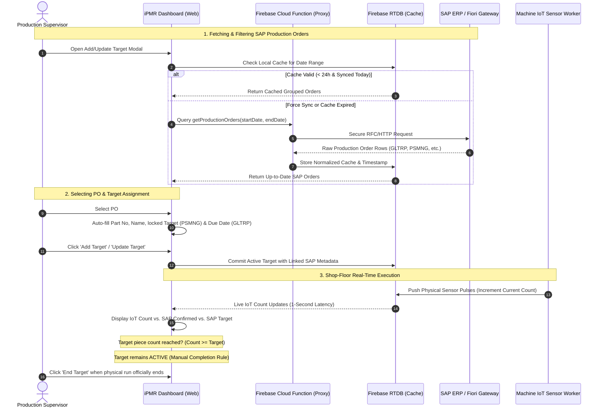

# iPMR × SAP ERP Integration: Production Targets Module
**Comprehensive Client & Stakeholder Documentation**  
*System Version: iPMR v3.0 | Status: Production Deployed*

| Parameter | Project & Implementation Details |
| :--- | :--- |
| **Client** | **Auvitronics Limited** *(Exclusive Enterprise Feature)* |
| **Feature Exclusivity** | **Designed, developed, and deployed ONLY for Auvitronics Limited** |
| **Document Date** | **17 Oct, 2026** |
| **Scope** | **47 Production Machines** (Port Qasim Plant: 29 machines \| Hub Plant: 18 machines) |
| **Execution Window** | **Standard Office Working Hours (9:00 AM – 6:00 PM)** |
| **Factory Personnel Required** | **1 Electrical Technician** (panel safety & isolation) + **1 Production Technician** |

---

## 1. Executive Summary

The **iPMR SAP ERP Integration** is a proprietary enterprise module developed **EXCLUSIVELY for Auvitronics Limited**. It establishes a direct, bidirectional bridge between Auvitronics' **SAP Production Orders (POs)** and the physical shop-floor machinery monitored by **iPMR IoT telemetry hardware** across the Port Qasim (29 machines) and Hub (18 machines) manufacturing facilities. 

Previously, machine operators and production supervisors manually transcribed target quantities, part numbers, and schedule deadlines from SAP sheets into the machine dashboard. This manual bridge introduced transcription errors, delayed progress tracking, and disconnected ERP planning from real-time floor execution.

### Key Business Outcomes
* **Zero Manual Transcription**: Target quantities, part descriptions, and due dates are populated directly from SAP with a single click.
* **Tamper-Proof Governance**: Target piece counts (`PSMNG`) lock directly to SAP specifications, preventing unauthorized on-floor quota modifications.
* **Dual-Track Visibility**: Floor supervisors monitor real-time physical sensor counts side-by-side with official SAP confirmed quantities (`LMNGA`).
* **Family Mold Compatibility**: Multi-part production orders are natively recognized, enabling operators to switch discrete parts under a single PO without reconfiguring targets.
* **Safe Floor Continuity**: Built-in **Manual Completion** prevents automated system shutoffs or premature target closure when quotas are met, allowing floor production to continue accumulating seamlessly until official supervisor handoff.

---

## 2. System Architecture & Data Flow

The integration connects SAP Fiori/ERP, Firebase Cloud Functions, Realtime Database (RTDB) high-speed caching, the iPMR Web Dashboard, and on-machine IoT telemetry sensors.

---

## 3. Core Feature Walkthrough

### 3.1. PO Selection & Intelligent Auto-Population
When creating or updating a production target, supervisors can search or select any active SAP Production Order directly from the dropdown.

* **Instant Search & Autocomplete**: Search by PO Number (e.g., `110100011769`) or Material Description (e.g., `BOARD, COWL SIDE TRIM`).
* **Locked Target Piece Count**: The target quantity field automatically pulls from SAP's Planned Quantity (`PSMNG`) and locks editing to preserve ERP integrity.
* **Automatic Due Date Mapping**: The target's deadline is automatically assigned from the PO's **Basic Finish Date (`GLTRP`)**, eliminating manual date calculations.
* **Custom Query Date Windows**: Supervisors can query SAP records using quick presets (*This Month*, *Last Month*, *Last 30 Days*, *Next 30 Days*) or enter custom start/end date ranges to fetch historic or upcoming production orders.

### 3.2. Family Molds & Multi-Material Orders
In plastic injection molding and progressive stamping, a single production run often produces multiple discrete parts (e.g., Left-Hand and Right-Hand trim boards) under one PO.

* **Automatic Family Mold Detection**: When a PO contains multiple materials, iPMR labels it with a **`[N] PARTS (FAMILY MOLD)`** indicator.
* **Interactive Part Switcher**: Supervisors can toggle between Part 1, Part 2, etc., within the modal.
* **Independent Quotas**: Switching parts dynamically updates the active part number, material description, and target quota while maintaining PO association.

### 3.3. Dual-Counter Live Monitoring
Once running, the active machine view displays a dedicated **SAP Target Summary** card with three live operational metrics:

| Metric | Source | Description |
| :--- | :--- | :--- |
| **SAP Target** | SAP ERP (`PSMNG`) | The planned quantity authorized by ERP planning. |
| **SAP Confirmed** | SAP ERP (`LMNGA`) | Pieces officially logged in SAP during previous shifts or ERP confirmations. |
| **Live iPMR Count** | Physical Hardware Sensor | High-speed, real-time sensor pulses recorded directly from machine cycling. |

> [!TIP]
> **Live Variance Tracking**: Floor supervisors can immediately spot discrepancies between ERP records and actual machine output in real-time (`Variance = Live iPMR Count - SAP Confirmed`).

### 3.4. Manual Completion Safeguard (Floor Continuity)
In conventional setups, automated targets automatically mark themselves as "Completed" and archive once the piece count reaches the target number. 

In real-world manufacturing, finishing a target piece count does **not** mean the machine immediately stops:
* Operators may produce a minor overrun to account for quality buffer.
* The machine continues cycling until maintenance or mold changeover begins.

**iPMR Protection**:
* Active SAP targets **never auto-complete** upon reaching 100%.
* Hardware sensors continue counting and accumulating total pieces.
* When the run physically concludes, the supervisor clicks **End Target** to manually sign off and archive the run.

---

## 4. SAP ERP Data Field Mapping

The table below outlines how fields in SAP ERP correspond to attributes inside the iPMR dashboard:

| SAP Field | SAP Description | iPMR Target Property | Functional Behavior in iPMR |
| :--- | :--- | :--- | :--- |
| `AUFNR` | Order Number | `sapOrder.orderNumber` | Primary order identification; displayed on cards and search dropdown. |
| `AUART` | Order Type | `sapOrder.status` | Identifies standard orders (e.g. `Z101`, `PP01`). |
| `MATNR` | Material Number | `sapOrder.materialNumber` | Machine-readable part identification code. |
| `MAKTX` | Material Description | `sapOrder.materialDesc` | Human-readable part name auto-filled into target title. |
| `PSMNG` | Order Target Quantity | `target.target` & `sapOrder.target` | Populates target piece count; locked against manual editing. |
| `LMNGA` | Confirmed Quantity | `sapOrder.confirmed` | Shows officially confirmed yield from ERP. |
| `GLTRP` | Basic Finish Date | `target.due` & `sapOrder.endDate` | Maps directly to the Target's Due Date. |
| `GSTRP` | Basic Start Date | `sapOrder.startDate` | Order scheduled release/start date. |

---

## 5. Network & Performance Optimization

To protect the client's SAP ERP infrastructure from excessive network loads, iPMR implements a tiered caching and rate-limiting strategy:

1. **Daily Auto-Sync & Cache**: Production orders fetched for a date range are stored in Firebase RTDB cache. Repeated modal openings load instantly from cache without pinging SAP.
2. **On-Demand "Sync SAP"**: Floor supervisors can click the **Sync SAP** button anytime to pull the freshest numbers directly from the ERP.
3. **10-Second Cooldown Throttling**: Double-clicking or spamming the refresh button is debounced with an active spinner and cooldown timer.
4. **Tenant Isolation**: SAP integration is strictly gated by Master User UID (`Q15Ie2n4GkY5uqbW1UJ9375vRF43`), preventing unauthorized factory accounts from calling SAP endpoints.

---

## 6. Verification & Deployment Summary

* **Frontend Build**: Verified via TypeScript strict compilation (0 errors, 0 warnings).
* **Live Hosting**: Deployed to production on Firebase Hosting ([https://industrialpmr-v3.web.app](https://industrialpmr-v3.web.app)).
* **Source Control**: Committed and pushed to repository master (`3926253`).
